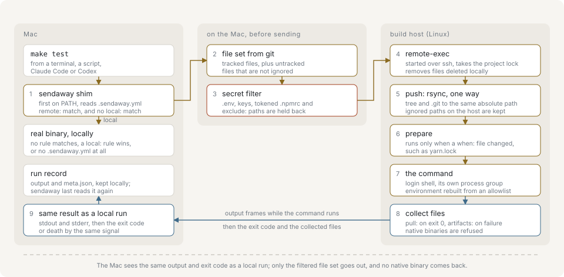

# sendaway

[](https://github.com/libraz/sendaway/actions)
[](https://github.com/libraz/sendaway/releases)
[](https://github.com/libraz/sendaway/blob/main/LICENSE)
[](https://go.dev/)
[](https://github.com/libraz/sendaway)
[](https://pkg.go.dev/github.com/libraz/sendaway)

**sendaway runs heavy build and test commands on a remote Linux machine, without changing the commands or the tools that call them.** It is a PATH shim: a `make test` typed by you, a script, Claude Code or Codex syncs the working tree, runs on the host, and returns the same output and exit code. A project opts in with one `.sendaway.yml`, and commands that match no rule run locally, unchanged.

📖 [Documentation](https://github.com/libraz/sendaway/blob/main/docs/en/introduction.md) &nbsp;·&nbsp; [Getting started](https://github.com/libraz/sendaway/blob/main/docs/en/getting-started.md) &nbsp;·&nbsp; [Build host](https://github.com/libraz/sendaway/blob/main/docs/en/build-host.md)

> Status: pre-1.0. The `.sendaway.yml` schema, the output lines and the wire protocol may change between releases.



## What it does

- **Transparent routing** — rules in `.sendaway.yml` match the command line (`[make]`, `[go, test]`); `local:` wins over `remote:`. [Configuration](https://github.com/libraz/sendaway/blob/main/docs/en/configuration.md)
- **Faithful results** — stdout and stderr order, exit codes and fatal signals come back as a local run would produce them. Ctrl-C and SIGTERM stop the remote process group. [How it works](https://github.com/libraz/sendaway/blob/main/docs/en/how-it-works.md)
- **Git-defined sync** — the files sent are those git tracks or does not ignore. Secret-looking files, `.git/config`, and `.npmrc` or `.yarnrc.yml` files that hold tokens are never sent. [Security](https://github.com/libraz/sendaway/blob/main/docs/en/security.md)
- **Per-project hosts** — `~/.config/sendaway/config.yml` maps project paths to ssh host aliases, so hosts and addresses stay out of repositories. [Configuration](https://github.com/libraz/sendaway/blob/main/docs/en/configuration.md#user-configuration)
- **Local fallback** — if the host is unreachable (name resolution, timeout, refused, no route), the command runs locally with a notice. Auth and host-key failures do not fall back. [Output and exit codes](https://github.com/libraz/sendaway/blob/main/docs/en/output-and-exit-codes.md)
- **Run records** — every run keeps its output and metadata; `sendaway last` summarizes the latest. [Command reference](https://github.com/libraz/sendaway/blob/main/docs/en/cli.md)

## Installation

The workstation runs macOS or Linux with git, OpenSSH and rsync 3.1 or later; the build host runs Linux. Windows is not supported.

```sh
go install github.com/libraz/sendaway/cmd/sendaway@latest
```

The build host needs the same version built for Linux, in `/usr/local/bin`:

```sh
GOOS=linux GOARCH=amd64 go build -o sendaway ./cmd/sendaway   # GOARCH=arm64 for an Arm host
```

`sendaway version` prints the version and protocol; both sides must agree on the protocol. On macOS, put a Homebrew rsync 3.x ahead of the system openrsync on PATH, since openrsync is too old. The host's own requirements (dedicated user, same parent path, quiet profile, clock sync) are listed in [Build host](https://github.com/libraz/sendaway/blob/main/docs/en/build-host.md).

## Getting started

1. Add a `Host build01` entry to `~/.ssh/config` with the address, user and key, and run `ssh build01` by hand once so the host key lands in `known_hosts`. Connections use `BatchMode`, so a host key prompt fails.
2. Create `~/.config/sendaway/config.yml`:

   ```yaml
   host: build01                  # default ssh alias
   routes:                        # longest path-component match wins
     - path: ~/Projects/big-repo
       host: build02
   ```

3. In each project root (the git top level), run `sendaway init` to write a `.sendaway.yml` from the files it finds, then edit it:

   ```yaml
   remote: [[make], [ctest]]
   local: [[make, format], [make, lint]]
   env: [TEST_FILTER, MYAPP_*]      # extra variable names to forward
   prepare:                         # run on the host when these files change
     - when: [yarn.lock, package.json]
       run: [yarn, install, --immutable]
   pull: [dist/wasm]                # copied back on exit 0
   artifacts: [build/Testing/Temporary/LastTest.log]   # copied back on failure
   exclude: [fixtures/private]      # never sent
   ```

4. Run `sendaway install-shims`, then put the printed `export PATH=...` line at the end of your shell startup file (`~/.zshrc`, `~/.bashrc`), after any `mise activate`.
5. Run `sendaway doctor` and fix every `FAIL`, then run `make test` as usual.

`sendaway which make test` shows where a command would run, the host and the forwarded variables. `sendaway run <cmd>` and `sendaway local <cmd>` ignore the rules. The full walkthrough, including how to read the `[sendaway]` lines, is in [Getting started](https://github.com/libraz/sendaway/blob/main/docs/en/getting-started.md).

## Build from source

```sh
make build    # bin/sendaway
make test     # unit tests with -race, then startup-time checks
make lint     # golangci-lint and actionlint
make e2e      # end-to-end tests against a Docker sshd
```

The binary must stay named `sendaway`: under any other name it acts as a shim for that command.

## For coding agents

Paste into `AGENTS.md` or `CLAUDE.md`:

```markdown
Builds and tests here run on a remote host through sendaway shims. Use the usual commands (`make test`, `ctest`).
stderr ends with `[sendaway] <host> exit N · <time> · run <id> · log <path>`; N is the command's exit code.
Exit 125 with no trailer means sendaway failed, not the command; the preceding `[sendaway]` line says why.
`sendaway last` summarizes the latest run, and the full output is in its log path.
If the trailer warns that the remote run modified files, add the target to `local:` or list the files in `pull:`.
Tests that need secret files run with `sendaway local <cmd>`.
```

If an output filter such as RTK rewrites commands, add the shim names to its exclude list; see [Coding agents](https://github.com/libraz/sendaway/blob/main/docs/en/coding-agents.md#output-filters).

## Documentation

The documentation lives in [`docs/`](https://github.com/libraz/sendaway/tree/main/docs), in English and Japanese.

- Learn — [Introduction](https://github.com/libraz/sendaway/blob/main/docs/en/introduction.md) · [Getting started](https://github.com/libraz/sendaway/blob/main/docs/en/getting-started.md) · [How it works](https://github.com/libraz/sendaway/blob/main/docs/en/how-it-works.md)
- Guides — [Configuration](https://github.com/libraz/sendaway/blob/main/docs/en/configuration.md) · [Build host](https://github.com/libraz/sendaway/blob/main/docs/en/build-host.md) · [Coding agents](https://github.com/libraz/sendaway/blob/main/docs/en/coding-agents.md) · [Security](https://github.com/libraz/sendaway/blob/main/docs/en/security.md)
- Reference — [Command reference](https://github.com/libraz/sendaway/blob/main/docs/en/cli.md) · [Output and exit codes](https://github.com/libraz/sendaway/blob/main/docs/en/output-and-exit-codes.md) · [Glossary](https://github.com/libraz/sendaway/blob/main/docs/en/glossary.md) · [FAQ and troubleshooting](https://github.com/libraz/sendaway/blob/main/docs/en/faq.md)

## Non-goals

- Interactive commands are not supported. The remote command has no tty and reads `/dev/null`.
- There is no continuous sync, daemon or load balancing. The tree is copied once per run, a project resolves to one host, and one command runs on one host.
- Submodules, nested repositories, git worktrees and non-NFC file names are not supported. They fail with exit 125 where detected.
- Windows is not supported as a workstation. The shim relies on Unix file locks, process groups and signals.
- The host holds no credentials. Tests that need secret or ignored files run locally with `sendaway local`.

The other limits (one run per project at a time, `setsid` escaping cleanup, forwarded `MAKEFLAGS`) are listed in [FAQ and troubleshooting](https://github.com/libraz/sendaway/blob/main/docs/en/faq.md#limitations).

## License

[Apache-2.0](LICENSE)
