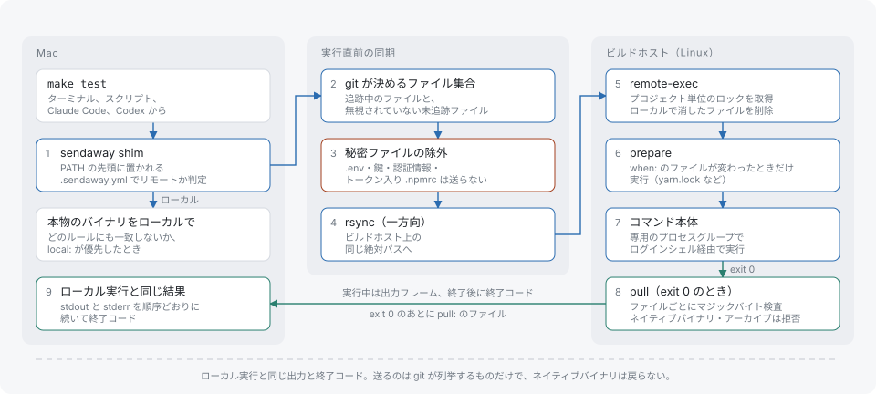

# sendaway

[](https://github.com/libraz/sendaway/actions)
[](https://github.com/libraz/sendaway/releases)
[](https://github.com/libraz/sendaway/blob/main/LICENSE)
[](https://go.dev/)
[](https://github.com/libraz/sendaway)
[](https://pkg.go.dev/github.com/libraz/sendaway)

**sendaway は、重いビルドやテストのコマンドを、コマンドも呼び出し元も変えずに遠隔の Linux マシンで実行します。** PATH shim として動くので、自分で打った `make test` も、スクリプトや Claude Code、Codex が呼んだ `make test` も、作業ツリーを同期して遠隔で走り、出力と終了コードをそのまま返します。プロジェクトの導入は `.sendaway.yml` 1 つで、どの規則にも一致しないコマンドは手元でそのまま実行されます。

📖 **[ドキュメント](https://github.com/libraz/sendaway/blob/main/docs/ja/introduction.md)** &nbsp;·&nbsp; **[はじめに](https://github.com/libraz/sendaway/blob/main/docs/ja/getting-started.md)** &nbsp;·&nbsp; **[ビルドホスト](https://github.com/libraz/sendaway/blob/main/docs/ja/build-host.md)**

> **Status:** 1.0 未満です。`.sendaway.yml` のスキーマ、出力行、ワイヤプロトコルはリリース間で変わることがあります。第三者による監査は受けていません。



## できること

- **透過的な振り分け** — `.sendaway.yml` の規則がコマンドラインに一致すると遠隔で実行します（`[make]`、`[go, test]`）。`local:` が `remote:` より優先されます。[設定](https://github.com/libraz/sendaway/blob/main/docs/ja/configuration.md)
- **手元と同じ結果** — stdout と stderr の順序、終了コード、致命的なシグナルが手元実行と同じ形で戻ります。Ctrl-C と SIGTERM は遠隔のプロセスグループを止めます。[動作の仕組み](https://github.com/libraz/sendaway/blob/main/docs/ja/how-it-works.md)
- **git で決まる同期** — 送るのは git が追跡する、または無視していないファイルです。秘密らしいファイル、`.git/config`、トークンを含む `.npmrc` や `.yarnrc.yml` は送りません。[セキュリティ](https://github.com/libraz/sendaway/blob/main/docs/ja/security.md)
- **プロジェクトごとのホスト** — `~/.config/sendaway/config.yml` がプロジェクトのパスを ssh のホスト別名に対応づけます。ホスト名やアドレスはリポジトリに載りません。[設定](https://github.com/libraz/sendaway/blob/main/docs/ja/configuration.md)
- **手元へのフォールバック** — ホストに届かないとき（名前解決の失敗、タイムアウト、接続拒否、経路なし）は、通知を出して手元で実行します。認証失敗とホスト鍵の不一致では手元に切り替えません。[FAQ](https://github.com/libraz/sendaway/blob/main/docs/ja/faq.md)
- **実行の記録** — 実行ごとに出力とメタデータを残し、`sendaway last` で直近の要約を見られます。[コマンドリファレンス](https://github.com/libraz/sendaway/blob/main/docs/ja/cli.md)

## インストール

```sh
go install github.com/libraz/sendaway/cmd/sendaway@latest
```

ビルドホストには、同じ版を Linux 用にビルドして `/usr/local/bin` に置きます。

```sh
GOOS=linux GOARCH=amd64 go build -o sendaway ./cmd/sendaway   # Arm のホストなら GOARCH=arm64
```

`sendaway version` が版と protocol を表示します。両側の protocol が一致している必要があります。

## はじめに

1. 最初に `ssh build01` を手で 1 回実行し、ホスト鍵を `known_hosts` に入れます。接続は `BatchMode` なので、ホスト鍵の確認が出ると失敗します。
2. `~/.ssh/config` に `Host build01` を書き、アドレス、ユーザー、鍵を指定します。接続情報は ssh_config だけから読みます。
3. `~/.config/sendaway/config.yml` を作ります。

   ```yaml
   host: build01                  # 既定の ssh 別名
   routes:                        # パス成分単位の最長一致が勝つ
     - path: ~/Projects/big-repo
       host: build02
   ```

4. 各プロジェクトのルート（git のトップレベル）で `sendaway init` を実行すると、見つかったファイルから `.sendaway.yml` を書きます。あとは編集します。

   ```yaml
   remote: [[make], [ctest]]
   local: [[make, format], [make, lint]]
   env: [TEST_FILTER, MYAPP_*]      # 追加で転送する変数名
   prepare:                         # これらのファイルが変わったときだけホストで実行
     - when: [yarn.lock, package.json]
       run: [yarn, install, --immutable]
   pull: [dist/wasm]                # 終了コード 0 のとき回収
   artifacts: [build/Testing/Temporary/LastTest.log]   # 失敗時に回収
   exclude: [fixtures/private]      # 送らない
   ```

5. `sendaway install-shims` を実行し、表示された `export PATH=...` の行を `~/.zshrc` の末尾（`mise activate` より後）に置きます。既定の shim は make、cmake、ctest、go、cargo、yarn、npm、pnpm、bun です。
6. `sendaway doctor` を実行します。各 shim が PATH の先頭にあるか、手元の rsync、制御ディレクトリ、各ホストの到達性・版・時計・シェルの出力を検査します。
7. RTK のように出力を書き換えるフィルタを使っているなら、shim 名をその除外リストに足します（RTK では `exclude_commands`）。契約行は stderr に出るため、ストリームを並べ替えるフィルタを通すと出力より前に移ります。

`sendaway which make test` は、コマンドの実行場所、ホスト、転送する変数を表示します。`sendaway run <cmd>` と `sendaway local <cmd>` は規則を無視します。`sendaway forget` はホスト上のプロジェクトのコピーと状態を消します。

## ソースからビルド

```sh
make build    # bin/sendaway
make test     # -race 付きの単体テスト、続けて起動時間の検査
make lint     # golangci-lint と actionlint
make e2e      # Docker の sshd に対する end-to-end テスト
```

バイナリ名は `sendaway` のままにしてください。別の名前で呼ぶと、その名前のコマンドの shim として動きます。

## 出力行と終了コード

sendaway が足す行はすべて stderr に出ます（stdout と stderr が同じファイルなら同じファイルに出ます）。

| 行または終了コード | 意味 |
|---|---|
| `[sendaway] build01 linux-amd64 · sync 0.42s` | 開始行。同期の後に出る |
| `[sendaway] not sent (secret-like): …` | 秘密フィルタで送らなかったファイル |
| `[sendaway] remote run modified N synced files (not copied back): …` | 遠隔の実行が同期済みファイルを書き換えた。対象を `local:` に足すか、ファイルを `pull:` に列挙する |
| `[sendaway] build01 exit 1 · 42.3s · run r-… · log <path>` | 末尾行。シグナル死のときは `exit N` が `killed by signal 15` になる |
| `[sendaway] build01 unreachable (<reason>), running locally` | 手元実行へのフォールバック |
| `[sendaway] waiting for lock (held by: <argv>, <time>, run <id>)` | 同じプロジェクトの別の実行がロックを持っている。ホスト側は `waiting for remote lock …` |
| `[sendaway] connection lost during sync — nothing ran` | 終了コード 125。コマンドは始まっていない |
| `[sendaway] connection lost during run — result unknown` | 終了コード 125。コマンドは走った可能性がある |
| 終了コード `0`〜`255` | コマンド自身の終了コード |
| シグナル死 | sendaway も同じシグナルで終了する |
| 終了コード `125` | sendaway 自身の失敗。直前の行に理由がある（認証失敗とホスト鍵の不一致では ssh 自身のメッセージ） |

## 動作要件

ビルドホスト（Linux）:

- 鍵認証のみ。`AllowAgentForwarding no`、`AllowTcpForwarding no`、`ClientAliveInterval 15`。
- 時刻同期（chrony など）。時計のずれが 2 秒を超えると通知し、60 秒を超えると実行を失敗させます。
- git の認証情報も他ホストへの鍵も置かず、sendaway を動かすユーザーに sudo を与えません。
- 手元と同じ絶対パスの親ディレクトリ（例: `/Users/<name>`）を作り、そのユーザーの所有にします。
- rsync 3.1 以上と、非ログインの ssh が見つける `/usr/local/bin` の `sendaway`。
- rc と profile は stdout に何も出力しないこと。非ログイン rc の出力はフレームを壊し、profile の出力はコマンドの stdout に混ざります。

手元: Homebrew の rsync 3.x を PATH の先頭に置きます。macOS 標準は openrsync のためです。git と OpenSSH も必要です。

## 制限事項

- 手元で始まった実行の子孫は手元に留まります。`local:` の規則やフォールバックで手元実行になると、プロセスツリー全体が Mac で動きます。
- `MAKEFLAGS` や `CMAKE_BUILD_PARALLEL_LEVEL` などの並列度の変数は遠隔にも渡ります。Mac 向けに立てた `-j2` はホストでも有効です。何を転送し何を落としたかは `sendaway which` で確認できます。
- 秘密ファイルを要するテストは手元に置いてください。無視対象のファイルを読むテストは、追跡されていなければ遠隔で失敗します。
- 対話型・tty を要するコマンド、submodule、入れ子のリポジトリ、git worktree、NFC でないファイル名は扱えません（検出できるものは終了コード 125）。
- 自分で `setsid` するプロセスは、中断しても後始末されません。
- 同じプロジェクトでは一度に 1 回しか実行できず、後続は待ちます。

## コーディングエージェント向け

`AGENTS.md` か `CLAUDE.md` に貼る例です。

```markdown
Builds and tests here run on a remote host through sendaway shims. Use the usual commands (`make test`, `ctest`).
stderr ends with `[sendaway] <host> exit N · <time> · run <id> · log <path>`; N is the command's exit code.
Exit 125 means sendaway failed, not the command; the preceding `[sendaway]` line says why.
`sendaway last` summarizes the latest run, and the full output is in its log path.
If the trailer warns that the remote run modified files, add the target to `local:` or list the files in `pull:`.
Tests that need secret files run with `sendaway local <cmd>`.
```

## ドキュメント

ドキュメントは [`docs/`](https://github.com/libraz/sendaway/tree/main/docs) に英語と日本語で置いています。

- **学ぶ** — [概要](https://github.com/libraz/sendaway/blob/main/docs/ja/introduction.md) · [はじめに](https://github.com/libraz/sendaway/blob/main/docs/ja/getting-started.md) · [動作の仕組み](https://github.com/libraz/sendaway/blob/main/docs/ja/how-it-works.md)
- **ガイド** — [設定](https://github.com/libraz/sendaway/blob/main/docs/ja/configuration.md) · [ビルドホスト](https://github.com/libraz/sendaway/blob/main/docs/ja/build-host.md) · [コーディングエージェント](https://github.com/libraz/sendaway/blob/main/docs/ja/coding-agents.md) · [セキュリティ](https://github.com/libraz/sendaway/blob/main/docs/ja/security.md)
- **リファレンス** — [コマンドリファレンス](https://github.com/libraz/sendaway/blob/main/docs/ja/cli.md) · [出力行と終了コード](https://github.com/libraz/sendaway/blob/main/docs/ja/output-and-exit-codes.md) · [よくある質問と制限](https://github.com/libraz/sendaway/blob/main/docs/ja/faq.md)

## ライセンス

[Apache-2.0](LICENSE)
