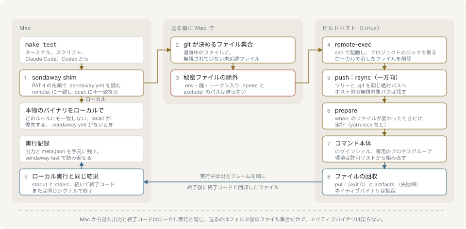

# sendaway

[](https://github.com/libraz/sendaway/actions)
[](https://github.com/libraz/sendaway/releases)
[](https://github.com/libraz/sendaway/blob/main/LICENSE)
[](https://go.dev/)
[](https://github.com/libraz/sendaway)
[](https://pkg.go.dev/github.com/libraz/sendaway)

**sendaway は、重いビルドやテストのコマンドを、コマンドも呼び出し元も変えずに遠隔の Linux マシンで実行します。** PATH shim として動くので、自分で打った `make test` も、スクリプトや Claude Code、Codex が呼んだ `make test` も、作業ツリーを同期して遠隔で走り、出力と終了コードをそのまま返します。プロジェクトの導入は `.sendaway.yml` 1 つで、どの規則にも一致しないコマンドは手元でそのまま実行されます。

📖 [ドキュメント](https://github.com/libraz/sendaway/blob/main/docs/ja/introduction.md) &nbsp;·&nbsp; [はじめに](https://github.com/libraz/sendaway/blob/main/docs/ja/getting-started.md) &nbsp;·&nbsp; [ビルドホスト](https://github.com/libraz/sendaway/blob/main/docs/ja/build-host.md)

> Status: 1.0 未満です。`.sendaway.yml` のスキーマ、出力行、ワイヤプロトコルはリリース間で変わることがあります。



## できること

- **透過的な振り分け** — `.sendaway.yml` の規則がコマンドラインに一致すると遠隔で実行します（`[make]`、`[go, test]`）。`local:` が `remote:` より優先されます。[設定](https://github.com/libraz/sendaway/blob/main/docs/ja/configuration.md)
- **手元と同じ結果** — stdout と stderr の順序、終了コード、致命的なシグナルが手元実行と同じ形で戻ります。Ctrl-C と SIGTERM は遠隔のプロセスグループを止めます。[動作の仕組み](https://github.com/libraz/sendaway/blob/main/docs/ja/how-it-works.md)
- **git で決まる同期** — 送るのは git が追跡する、または無視していないファイルです。秘密らしいファイル、`.git/config`、トークンを含む `.npmrc` や `.yarnrc.yml` は送りません。[セキュリティ](https://github.com/libraz/sendaway/blob/main/docs/ja/security.md)
- **プロジェクトごとのホスト** — `~/.config/sendaway/config.yml` がプロジェクトのパスを ssh のホスト別名に対応づけます。ホスト名やアドレスはリポジトリに載りません。[設定](https://github.com/libraz/sendaway/blob/main/docs/ja/configuration.md#ユーザー設定)
- **手元へのフォールバック** — ホストに届かないとき（名前解決の失敗、タイムアウト、接続拒否、経路なし）は、通知を出して手元で実行します。認証失敗とホスト鍵の不一致では手元に切り替えません。[出力と終了コード](https://github.com/libraz/sendaway/blob/main/docs/ja/output-and-exit-codes.md)
- **実行の記録** — 実行ごとに出力とメタデータを残し、`sendaway last` で直近の要約を見られます。[コマンドリファレンス](https://github.com/libraz/sendaway/blob/main/docs/ja/cli.md)

## インストール

手元のワークステーションは macOS か Linux で、git、OpenSSH、rsync 3.1 以上が必要です。ビルドホストは Linux です。Windows には対応していません。

```sh
go install github.com/libraz/sendaway/cmd/sendaway@latest
```

ビルドホストには、同じ版を Linux 用にビルドして `/usr/local/bin` に置きます。

```sh
GOOS=linux GOARCH=amd64 go build -o sendaway ./cmd/sendaway   # Arm のホストなら GOARCH=arm64
```

`sendaway version` が版と protocol を表示します。両側の protocol が一致している必要があります。macOS では、標準の openrsync が古すぎるため、Homebrew の rsync 3.x をそれより前に置きます。ホスト側の要件（専用ユーザー、同じ親パス、出力しない profile、時刻同期）は [ビルドホスト](https://github.com/libraz/sendaway/blob/main/docs/ja/build-host.md) にまとめています。

## はじめに

1. `~/.ssh/config` に `Host build01` を書いてアドレス、ユーザー、鍵を指定し、`ssh build01` を手で 1 回実行してホスト鍵を `known_hosts` に入れます。接続は `BatchMode` なので、ホスト鍵の確認が出ると失敗します。
2. `~/.config/sendaway/config.yml` を作ります。

   ```yaml
   host: build01                  # 既定の ssh 別名
   routes:                        # パス成分単位の最長一致が勝つ
     - path: ~/Projects/big-repo
       host: build02
   ```

3. 各プロジェクトのルート（git のトップレベル）で `sendaway init` を実行すると、見つかったファイルから `.sendaway.yml` を書きます。あとは編集します。

   ```yaml
   remote: [[make], [ctest]]
   local: [[make, format], [make, lint]]
   env: [TEST_FILTER, MYAPP_*]      # 追加で転送する変数名
   prepare:                         # これらのファイルが変わったときだけホストで実行
     - when: [yarn.lock, package.json]
       run: [yarn, install, --immutable]
   pull: [dist/wasm]                # 終了コード 0 のとき回収
   artifacts: [build/Testing/Temporary/LastTest.log]   # 失敗時に回収
   exclude: [fixtures/private]      # 送らない
   ```

4. `sendaway install-shims` を実行し、表示された `export PATH=...` の行をシェルの起動ファイル（`~/.zshrc`、`~/.bashrc` など）の末尾、`mise activate` より後に置きます。
5. `sendaway doctor` を実行して `FAIL` をすべて解消したら、いつもどおり `make test` を実行します。

`sendaway which make test` は、コマンドの実行場所、ホスト、転送する変数を表示します。`sendaway run <cmd>` と `sendaway local <cmd>` は規則を無視します。`[sendaway]` 行の読み方を含む詳しい手順は [はじめに](https://github.com/libraz/sendaway/blob/main/docs/ja/getting-started.md) にあります。

## ソースからビルド

```sh
make build    # bin/sendaway
make test     # -race 付きの単体テスト、続けて起動時間の検査
make lint     # golangci-lint と actionlint
make e2e      # Docker の sshd に対する end-to-end テスト
```

バイナリ名は `sendaway` のままにしてください。別の名前で呼ぶと、その名前のコマンドの shim として動きます。

## コーディングエージェント向け

`AGENTS.md` か `CLAUDE.md` に貼る例です。

```markdown
Builds and tests here run on a remote host through sendaway shims. Use the usual commands (`make test`, `ctest`).
stderr ends with `[sendaway] <host> exit N · <time> · run <id> · log <path>`; N is the command's exit code.
Exit 125 with no trailer means sendaway failed, not the command; the preceding `[sendaway]` line says why.
`sendaway last` summarizes the latest run, and the full output is in its log path.
If the trailer warns that the remote run modified files, add the target to `local:` or list the files in `pull:`.
Tests that need secret files run with `sendaway local <cmd>`.
```

RTK のようにコマンドの出力を書き換えるフィルタを使っているなら、shim 名をその除外リストに足します。詳しくは [コーディングエージェント](https://github.com/libraz/sendaway/blob/main/docs/ja/coding-agents.md#出力フィルタ) を参照してください。

## ドキュメント

ドキュメントは [`docs/`](https://github.com/libraz/sendaway/tree/main/docs) に英語と日本語で置いています。

- 学ぶ — [概要](https://github.com/libraz/sendaway/blob/main/docs/ja/introduction.md) · [はじめに](https://github.com/libraz/sendaway/blob/main/docs/ja/getting-started.md) · [動作の仕組み](https://github.com/libraz/sendaway/blob/main/docs/ja/how-it-works.md)
- ガイド — [設定](https://github.com/libraz/sendaway/blob/main/docs/ja/configuration.md) · [ビルドホスト](https://github.com/libraz/sendaway/blob/main/docs/ja/build-host.md) · [コーディングエージェント](https://github.com/libraz/sendaway/blob/main/docs/ja/coding-agents.md) · [セキュリティ](https://github.com/libraz/sendaway/blob/main/docs/ja/security.md)
- リファレンス — [コマンドリファレンス](https://github.com/libraz/sendaway/blob/main/docs/ja/cli.md) · [出力と終了コード](https://github.com/libraz/sendaway/blob/main/docs/ja/output-and-exit-codes.md) · [用語集](https://github.com/libraz/sendaway/blob/main/docs/ja/glossary.md) · [FAQ とトラブルシューティング](https://github.com/libraz/sendaway/blob/main/docs/ja/faq.md)

## 含まないもの（Non-goals）

- 対話型のコマンドは扱いません。遠隔のコマンドには tty がなく、標準入力は `/dev/null` です。
- 常時同期、デーモン、負荷分散はありません。ツリーは実行ごとに 1 回だけ送り、1 つのプロジェクトは 1 台のホストに決まり、1 つのコマンドは 1 台で動きます。
- submodule、入れ子のリポジトリ、git worktree、NFC でないファイル名は扱いません。検出できたものは終了コード 125 で失敗します。
- Windows のワークステーションには対応していません。shim が Unix のファイルロック、プロセスグループ、シグナルに依存しているためです。
- ホストには資格情報を置きません。秘密ファイルや無視対象のファイルを要するテストは `sendaway local` で手元で実行します。

ほかの制限（`slots` を設定しない限り同じプロジェクトでは同時に 1 回だけ実行、`setsid` したプロセスは後始末の対象外、`MAKEFLAGS` の転送）は [FAQ とトラブルシューティング](https://github.com/libraz/sendaway/blob/main/docs/ja/faq.md#制限事項) にあります。

## ライセンス

[Apache-2.0](LICENSE)
