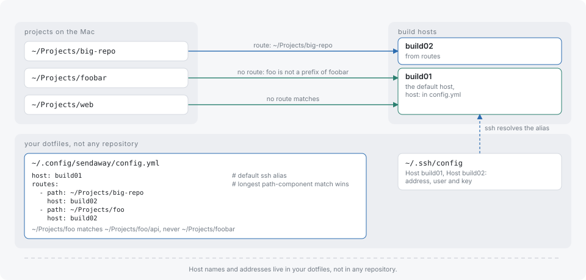

# Configuration

sendaway reads two YAML files. `.sendaway.yml` lives in a project and says which commands run remotely and what travels with them. `~/.config/sendaway/config.yml` lives in the user's home and says which host a project uses. Hosts and addresses stay out of repositories.

Both files are validated strictly: an unknown or duplicate key, a value of the wrong type, or an invalid path is an error. An empty file is valid. Errors are reported as `<file>:<line>: <message>` after the `[sendaway]` prefix, and the run exits with 125 before the command starts.

## Project configuration

`.sendaway.yml` must sit at the git top level of the project, next to a `.git` directory. All keys are optional.

```yaml
remote: [[make], [ctest]]
local: [[make, format], [make, lint]]
env: [TEST_FILTER, MYAPP_*]
prepare:
  - when: [yarn.lock, package.json]
    run: [yarn, install, --immutable]
pull: [dist/wasm]
artifacts: [build/Testing/Temporary/LastTest.log]
exclude: [fixtures/private]
```

### Finding the file

A shim searches upward from the current directory (symlinks resolved) for `.sendaway.yml`. The search stops at the parent of `$HOME`, which is not searched, so a file in `$HOME` itself is found and one above it is not. With no file found, the command runs locally.

### `remote` and `local`: rule syntax

Each entry is a list of words: a program name followed by optional argument patterns.

```yaml
remote:
  - [make]
  - [go, test]
local:
  - [make, format]
  - [yarn, "install*"]
```

A rule matches a command line when:

- the program word equals the basename of `argv[0]`, so `/usr/bin/make` matches `[make]`;
- every following word matches, in order, an element of `argv[1:]`. Words are `path.Match` globs (`*`, `?`, `[...]`) matched against whole arguments, and other arguments may sit between the matches.

So `[make, test]` matches `make test`, `make -j4 test` and `make -C sub test`, but not `make tests`. The program word is compared literally and is never a glob. A rule is matched against the argument vector only; shell strings, pipes and `&&` are not interpreted.

A command runs remotely when a `remote:` rule matches and no `local:` rule does. A `local:` match always wins, and a command matching neither runs locally. Because words are globs, a literal `[` in an argument needs escaping with a backslash.

Validation errors: `a remote rule must be a list of words`, `empty remote rule`, `empty program name in remote rule`, `invalid glob "<word>" in remote rule` (the same messages apply to `local`).

`sendaway which <command>` prints the decision and the rule behind it.

### `env`

The environment of the remote command is rebuilt from a fixed allowlist (see [Security](security.md#environment-variables)). `env:` adds names to it:

```yaml
env: [TEST_FILTER, MYAPP_*]
```

An entry is an exact variable name, or a name with a trailing `*` that matches every variable starting with the prefix. A name containing `=`, whitespace or a `*` other than the last character is rejected with `invalid variable name "<name>"`. Secret-looking names and values that only make sense on the Mac are dropped even when listed; `sendaway which` reports them.

### `prepare`

`prepare` lists setup commands that run on the host before the command, only when their inputs changed:

```yaml
prepare:
  - when: [yarn.lock, package.json]
    run: [yarn, install, --immutable]
```

- `when` is a non-empty list of root-relative file paths. `run` is a non-empty command as a list of words; it is not a shell string.
- A rule runs when the combined content hash of its `when` files differs from the hash recorded after its last successful run, and on the first run in a fresh host state. After `sendaway forget` every rule runs again.
- The hash is per rule, keyed by its `when` list. Rules run in the order listed, in the project root, with the same login shell and environment as the command.
- Output of a prepare command appears as `[sendaway]` lines.
- A rule that fails ends the run with exit 125 (`prepare <command> exited N`) and keeps its previous hash, so it runs again next time.
- Every `when` file must exist on the host. A file that sendaway withholds as secret-like is not there, so it cannot be a `when` file.

Validation errors: `prepare rule needs a non-empty when`, `prepare rule needs a non-empty run`, `a prepare rule must be a mapping with when and run`.

### `pull`

`pull` lists root-relative paths copied from the host back into the same place in the local tree after a command exits with code 0. A directory is copied recursively.

- A path that does not exist on the host fails the run with exit 125 (`pull path does not exist: <path>`).
- Symlinks, native binaries (ELF, Mach-O, PE, `ar` archives) and archives (zip, gzip, xz, zstd, bzip2, tar) are refused. If anything is refused, nothing is copied and the run fails with `pull refused: <path> (<reason>), ...`.
- A destination whose path contains a symlink locally is refused with `pull destination <path> is a symlink; refusing to write through it`.
- Copied files overwrite local files. Files that a pull brings back are not counted in the modified-file warning.

Use `pull` for generated sources and text or WASM outputs that the local toolchain needs.

### `artifacts`

`artifacts` lists root-relative paths copied back only when the command fails (non-zero exit or a signal). They are stored under the run's `artifacts/` directory, not in the project tree, so a failed run never overwrites local files.

- A missing path is skipped.
- Symlinks and native binaries are refused; archives are accepted. Refused paths are reported as `artifacts not collected: <path> (<reason>)` and do not change the exit code.
- The total size is capped at 64 MiB; files beyond it are refused with reason `limit`.

### `exclude`

`exclude` lists root-relative paths that are never sent to the host:

```yaml
exclude: [fixtures/private, docs/large.pdf]
```

- A path names itself and everything under it. `fixtures/private` excludes the directory and all its files.
- There is no globbing: `*.log` is a literal file name.
- A path is cleaned (`./a//b/` becomes `a/b`) and must be relative, free of `..`, and not the root itself. Violations are reported as `empty path`, `absolute path "<path>" is outside the project root`, `path "<path>" contains ".." and leaves the project root` or `path "<path>" names the project root itself`.
- Excluded tracked files that exist locally are listed in the `not sent (secret-like)` line, and are removed from the host if a previous run sent them.

The same path rules apply to `pull`, `artifacts` and `when`.

## User configuration

`~/.config/sendaway/config.yml` (`$XDG_CONFIG_HOME/sendaway/config.yml` when set) maps projects to hosts. A missing file is an empty configuration, and a project with no resolved host fails with `no host configured (set host: or a matching route in <path>)`.



```yaml
host: build01
routes:
  - path: ~/Projects/big-repo
    host: build02
ssh_config: ~/.ssh/config.sendaway
```

### `host`

The default ssh alias. It must not be empty, start with `-`, or contain whitespace. It names a `Host` entry in the ssh configuration; the address, user and key come from there.

### `routes`

A list of `path` and `host` pairs. Both are required.

- `path` is absolute or starts with `~/`. Symlinks are resolved when the path exists, so a route written through a symlink matches the real location of a project.
- A route applies to a project whose root equals `path` or lies below it. Matching is by whole path components: `~/Projects/big` does not match `~/Projects/big-repo`.
- When several routes match, the one with the longest path wins. With no match, `host` is used. With no `host` either, there is no host.
- Duplicate paths are rejected: `duplicate route path "<path>"`.

### `ssh_config`

An alternative ssh configuration file, passed to ssh and rsync as `-F`. A leading `~` is expanded. When unset, ssh uses its default configuration.

## Where state lives

| Location | Content |
|---|---|
| `${XDG_STATE_HOME:-~/.local/state}/sendaway/runs/` | Run records |
| `${XDG_STATE_HOME:-~/.local/state}/sendaway/locks/` | Per-project local locks |
| `${XDG_STATE_HOME:-~/.local/state}/sendaway/cm/` | ssh control sockets |
| `${XDG_DATA_HOME:-~/.local/share}/sendaway/bin/` | Shims |
| `${XDG_STATE_HOME:-~/.local/state}/sendaway/repos/` on the host | Remote per-project state |
