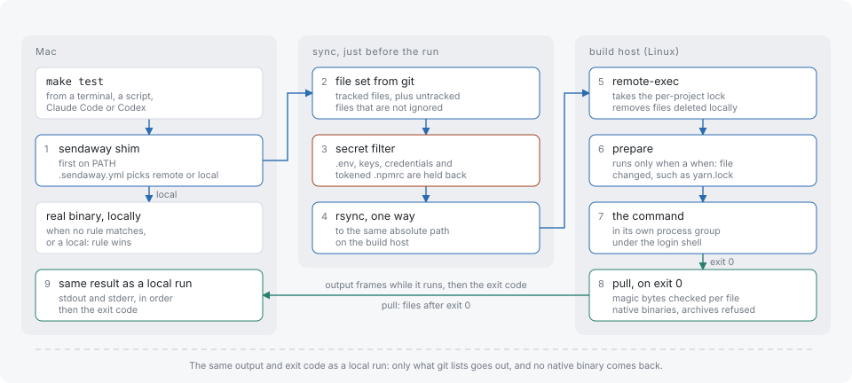

# Introduction

sendaway runs heavy build and test commands on a remote Linux host without changing the commands or the tools that call them. It is a PATH shim: `make test` typed by a person, a script, Claude Code or Codex is intercepted, the working tree is synced to the host, the command runs there, and the output and exit code come back as a local run would produce them.

A project opts in with one `.sendaway.yml` at its git top level. Commands that match no rule run locally, unchanged.

## Mental model

1. **Shim.** The `sendaway` binary is linked under the names of the commands it should intercept (`make`, `go`, `yarn` and so on). When the binary runs under any other name than `sendaway`, it acts as a shim for that command.
2. **Rule match.** The shim finds `.sendaway.yml` above the current directory and compares the command line with the `remote:` and `local:` rules. A `local:` match wins. A command that matches nothing, or a directory with no `.sendaway.yml`, runs the real binary directly.
3. **One-way sync just before the run.** The files git tracks, plus untracked files git does not ignore, are copied to the same absolute path on the host with rsync. Secret-looking files are held back. Nothing flows from the host to the Mac during the sync.
4. **Remote process group.** The host starts the command through a login shell in its own process group, with an environment rebuilt from a short allowlist.
5. **Frames back.** Output, notes and the exit status return over the single ssh connection as length-prefixed frames. The shim writes them to its own stdout and stderr and ends with the same exit code, or dies by the same signal.
6. **Collection.** Paths listed in `pull:` are copied back after a successful run, and paths listed in `artifacts:` after a failed one.

Every run is recorded locally with its output, so a result can be read again with `sendaway last`.

## What sendaway is not

- It installs no agent or daemon on the host. The host needs the same `sendaway` binary, started on demand over ssh as `sendaway remote-exec`.
- It does not sync continuously. The tree is copied once per run, immediately before the command.
- It does not balance load across hosts. A project resolves to exactly one host through the user configuration.
- It does not distribute a compilation across machines. One command runs on one host.
- It does not run interactive or tty commands. The command has no terminal and its stdin is `/dev/null`.
- It does not support git submodules, nested repositories, git worktrees, or file names that are not stored in NFC on disk. A tree containing them fails with exit 125 where detected.
- It does not clean up processes that leave the process group by calling `setsid` themselves.
- It does not authenticate to private package registries. The host holds no credentials, and `.npmrc` or `.yarnrc.yml` files carrying tokens are not sent.

## Where to go next

- [Getting started](getting-started.md) installs sendaway and runs a first command.
- [Configuration](configuration.md) documents both configuration files.
- [How it works](how-it-works.md) follows one run step by step.
- [Security](security.md) lists what reaches the host and what stays local.
- [Build host](build-host.md) describes the Linux side.
- [Coding agents](coding-agents.md) covers Claude Code and Codex.
- [Command reference](cli.md), [output and exit codes](output-and-exit-codes.md) and the [FAQ](faq.md) are reference pages.
