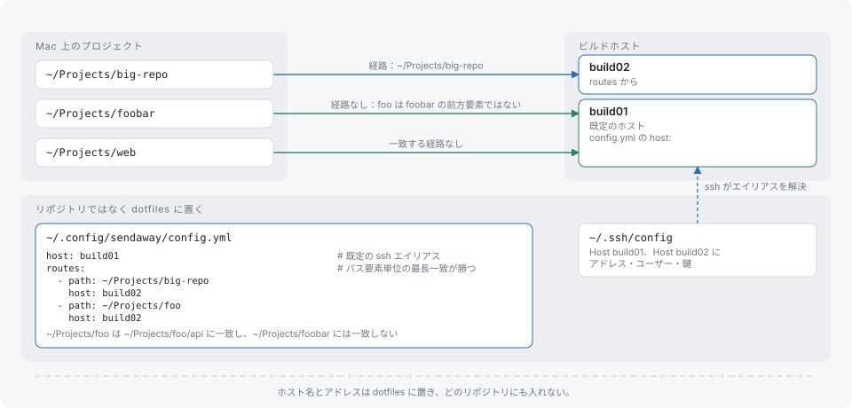

# 設定

sendaway は 2 つの YAML ファイルを読みます。`.sendaway.yml` はプロジェクトの中にあり、どのコマンドをリモートで実行するか、何を一緒に運ぶかを決めます。`~/.config/sendaway/config.yml` はユーザーのホームにあり、プロジェクトがどのホストを使うかを決めます。ホストやアドレスはリポジトリに入りません。

どちらのファイルも厳密に検証されます。未知のキー、重複したキー、型の違う値、不正なパスはエラーになります。空のファイルは有効です。エラーは `[sendaway]` の接頭辞の後に `<file>:<line>: <message>` の形で報告され、実行はコマンドの開始前に終了コード 125 で終わります。

## プロジェクト設定

`.sendaway.yml` は、プロジェクトの git トップレベルの、`.git` ディレクトリの隣に置く必要があります。キーはすべて省略できます。

```yaml
remote: [[make], [ctest]]
local: [[make, format], [make, lint]]
env: [TEST_FILTER, MYAPP_*]
prepare:
  - when: [yarn.lock, package.json]
    run: [yarn, install, --immutable]
pull: [dist/wasm]
artifacts: [build/Testing/Temporary/LastTest.log]
exclude: [fixtures/private]
```

### ファイルの探索

shim は、カレントディレクトリ（シンボリックリンクは解決済み）から上へ向かって `.sendaway.yml` を探します。探索は `$HOME` の親で止まり、その親自体は探索されません。したがって `$HOME` 直下のファイルは見つかり、それより上のファイルは見つかりません。ファイルが見つからなければ、コマンドはローカルで実行されます。

### `remote` と `local` のルール書式

各エントリは単語のリストで、プログラム名の後にオプションで引数パターンが続きます。

```yaml
remote:
  - [make]
  - [go, test]
local:
  - [make, format]
  - [yarn, "install*"]
```

ルールがコマンドラインに一致する条件は次のとおりです。

- プログラムの単語が `argv[0]` のベース名と等しい。たとえば `/usr/bin/make` は `[make]` に一致します。
- 続く各単語が、`argv[1:]` の要素に順番に一致する。単語は `path.Match` のグロブ（`*`、`?`、`[...]`）で、引数全体に対して照合され、一致する引数の間にほかの引数が挟まっていても構いません。

たとえば `[make, test]` は `make test`、`make -j4 test`、`make -C sub test` に一致しますが、`make tests` には一致しません。プログラムの単語はそのまま比較され、グロブにはなりません。ルールは引数ベクタだけに照合されます。シェルの文字列、パイプ、`&&` は解釈されません。

`remote:` のルールに一致し、かつ `local:` のルールに一致しないコマンドが、リモートで実行されます。`local:` に一致すれば常にそちらが優先され、どちらにも一致しないコマンドはローカルで実行されます。単語はグロブなので、引数の中の `[` をそのまま書くには、バックスラッシュでエスケープします。

検証エラーは次のとおりです。`a remote rule must be a list of words`、`empty remote rule`、`empty program name in remote rule`、`invalid glob "<word>" in remote rule`（`local` にも同じメッセージが使われます）。

`sendaway which <command>` は、判断とその根拠のルールを表示します。

### `env`

リモートで動くコマンドの環境は、固定の許可リストから組み立て直されます（[セキュリティ](security.md#環境変数)を参照）。`env:` は、そこに名前を追加します。

```yaml
env: [TEST_FILTER, MYAPP_*]
```

エントリは、変数名そのものか、末尾に `*` を付けた名前です。後者は、その接頭辞で始まるすべての変数に一致します。`=` や空白を含む名前、または末尾以外に `*` を含む名前は、`invalid variable name "<name>"` で拒否されます。シークレットらしい名前や、Mac でしか意味を持たない値は、列挙されていても除外されます。`sendaway which` がそれを報告します。

### `prepare`

`prepare` は、コマンドの前にホストで実行するセットアップコマンドを列挙します。実行されるのは入力が変化したときだけです。

```yaml
prepare:
  - when: [yarn.lock, package.json]
    run: [yarn, install, --immutable]
```

- `when` はルート相対のファイルパスの、空でないリストです。`run` は単語のリストで表した空でないコマンドで、シェル文字列ではありません。
- ルールが実行されるのは、`when` の各ファイルの内容を合わせたハッシュが、前回の成功後に記録したハッシュと異なる場合と、新しいホスト状態での最初の実行です。`sendaway forget` の後は、すべてのルールが再び実行されます。
- ハッシュはルールごとに、その `when` のリストをキーとして保持されます。ルールは列挙された順に、プロジェクトのルートで、コマンドと同じログインシェルと環境で実行されます。
- prepare コマンドの出力は `[sendaway]` の行として表示されます。
- 失敗したルールは実行を終了コード 125（`prepare <command> exited N`）で終わらせ、前回のハッシュを保つので、次回も再び実行されます。
- `when` の各ファイルはホストに存在する必要があります。sendaway がシークレットらしいとして送らなかったファイルはホストにないので、`when` のファイルにはできません。

検証エラーは次のとおりです。`prepare rule needs a non-empty when`、`prepare rule needs a non-empty run`、`a prepare rule must be a mapping with when and run`。

### `pull`

`pull` は、コマンドが終了コード 0 で終わった後に、ホストからローカルツリーの同じ場所へコピーして戻すルート相対のパスを列挙します。ディレクトリは再帰的にコピーされます。

- ホストに存在しないパスがあると、実行は終了コード 125 で失敗します（`pull path does not exist: <path>`）。
- シンボリックリンク、ネイティブバイナリ（ELF、Mach-O、PE、`ar` アーカイブ）、アーカイブ（zip、gzip、xz、zstd、bzip2、tar）は拒否されます。1 つでも拒否されると何もコピーされず、実行は `pull refused: <path> (<reason>), ...` で失敗します。
- ローカルでパスの途中にシンボリックリンクを含む宛先は、`pull destination <path> is a symlink; refusing to write through it` で拒否されます。
- コピーされたファイルはローカルのファイルを上書きします。pull で戻ってきたファイルは、変更ファイルの警告の数に含まれません。

`pull` は、ローカルのツールチェーンが必要とする生成ソースや、テキスト、WASM の出力に使います。

### `artifacts`

`artifacts` は、コマンドが失敗したとき（ゼロ以外の終了コード、またはシグナル）にだけコピーして戻すルート相対のパスを列挙します。コピー先はプロジェクトのツリーではなく実行の `artifacts/` ディレクトリなので、失敗した実行がローカルのファイルを上書きすることはありません。

- 存在しないパスは飛ばされます。
- シンボリックリンクとネイティブバイナリは拒否され、アーカイブは受け付けられます。拒否されたパスは `artifacts not collected: <path> (<reason>)` として報告され、終了コードは変わりません。
- 合計サイズの上限は 64 MiB です。超えた分のファイルは、理由 `limit` で拒否されます。

### `exclude`

`exclude` は、ホストへ送らないルート相対のパスを列挙します。

```yaml
exclude: [fixtures/private, docs/large.pdf]
```

- パスは、そのパス自身とその配下すべてを指します。`fixtures/private` は、そのディレクトリとすべてのファイルを除外します。
- グロブは使えません。`*.log` はそのままのファイル名として扱われます。
- パスは正規化され（`./a//b/` は `a/b` になります）、相対パスで、`..` を含まず、ルート自身でない必要があります。違反は `empty path`、`absolute path "<path>" is outside the project root`、`path "<path>" contains ".." and leaves the project root`、`path "<path>" names the project root itself` として報告されます。
- ローカルに存在する、追跡されている除外ファイルは `not sent (secret-like)` の行に列挙され、前回の実行で送られていた場合はホストから削除されます。

`pull`、`artifacts`、`when` にも同じパスの規則が適用されます。

## ユーザー設定

`~/.config/sendaway/config.yml`（設定されている場合は `$XDG_CONFIG_HOME/sendaway/config.yml`）は、プロジェクトをホストに対応づけます。ファイルがなければ空の設定として扱われ、ホストが決まらないプロジェクトは `no host configured (set host: or a matching route in <path>)` で失敗します。



```yaml
host: build01
routes:
  - path: ~/Projects/big-repo
    host: build02
ssh_config: ~/.ssh/config.sendaway
```

### `host`

既定の ssh 別名です。空にしたり、`-` で始めたり、空白を含めたりすることはできません。ssh の設定にある `Host` エントリの名前を指し、アドレス、ユーザー、鍵はそこから取られます。

### `routes`

`path` と `host` の組のリストです。どちらも必須です。

- `path` は絶対パスか、`~/` で始まるパスです。パスが存在する場合はシンボリックリンクが解決されるため、シンボリックリンク経由で書いたルートも、プロジェクトの実際の場所に一致します。
- ルートは、プロジェクトのルートが `path` と等しいか、その配下にある場合に適用されます。照合はパス要素の単位で行われ、`~/Projects/big` は `~/Projects/big-repo` に一致しません。
- 複数のルートが一致する場合は、最も長い `path` のものが選ばれます。一致するものがなければ `host` が使われ、`host` もなければホストはありません。
- 重複した `path` は `duplicate route path "<path>"` で拒否されます。

### `ssh_config`

別の ssh 設定ファイルで、`-F` として ssh と rsync に渡されます。先頭の `~` は展開されます。未設定の場合、ssh は既定の設定を使います。

## 状態の保存場所

| 場所 | 内容 |
|---|---|
| `${XDG_STATE_HOME:-~/.local/state}/sendaway/runs/` | 実行記録 |
| `${XDG_STATE_HOME:-~/.local/state}/sendaway/locks/` | プロジェクトごとのローカルロック |
| `${XDG_STATE_HOME:-~/.local/state}/sendaway/cm/` | ssh の control ソケット |
| `${XDG_DATA_HOME:-~/.local/share}/sendaway/bin/` | shim |
| ホスト上の `${XDG_STATE_HOME:-~/.local/state}/sendaway/repos/` | プロジェクトごとのリモート状態 |
