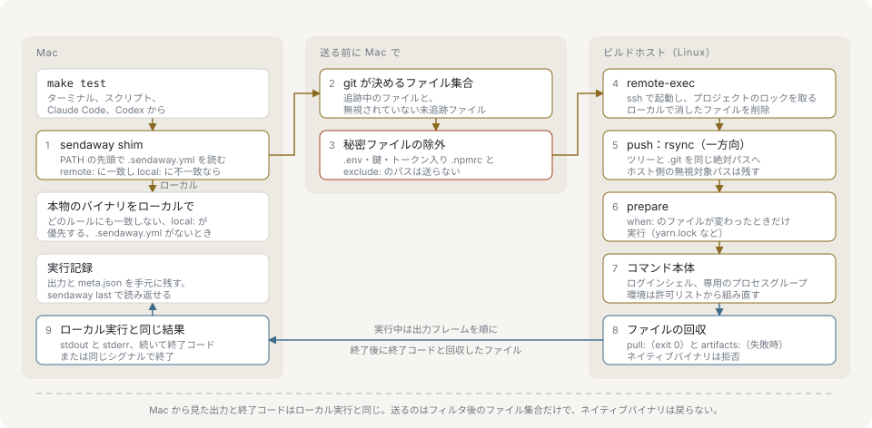

# 概要

sendaway は、重いビルドやテストのコマンドを、コマンドも呼び出し元のツールも変えずにリモートの Linux ホストで実行します。仕組みは PATH shim です。人間、スクリプト、Claude Code、Codex のいずれが入力した `make test` も途中で捕捉し、作業ツリーをホストへ同期してホスト上で実行し、出力と終了コードをローカル実行と同じ形で返します。

プロジェクトは、git のトップレベルに `.sendaway.yml` を 1 つ置くだけで利用を始められます。どのルールにも一致しないコマンドは、変更されずにローカルで実行されます。

## 動作モデル

1. **shim**：`sendaway` バイナリを、横取りしたいコマンドの名前（`make`、`go`、`yarn` など）でリンクします。バイナリが `sendaway` 以外の名前で起動されると、そのコマンドの shim として動作します。
2. **ルール照合**：shim はカレントディレクトリより上にある `.sendaway.yml` を探し、コマンドラインを `remote:` と `local:` のルールに照合します。`local:` に一致すれば常にローカルです。どれにも一致しないコマンドと、`.sendaway.yml` のないディレクトリでは、本物のバイナリをそのまま実行します。
3. **実行直前の一方向同期**：git が追跡するファイルと、git が無視していない未追跡ファイルを、rsync でホスト上の同じ絶対パス（[スロット](configuration.md#slots)のコピーは `<root>.slot-<n>`）へコピーします。シークレットらしいファイルは送りません。同期中にホストから Mac へ流れるものはありません。
4. **リモートのプロセスグループ**：ホストはコマンドを、専用のプロセスグループでログインシェル経由で起動します。環境は短い許可リストから組み立て直します。
5. **フレームの返送**：出力、通知、終了ステータスは、1 本の ssh 接続上で長さ接頭辞つきのフレームとして返ります。shim はそれを自身の stdout と stderr に書き出し、同じ終了コードで終了するか、同じシグナルで終了します。
6. **回収**：`pull:` に列挙したパスは成功後に、`artifacts:` に列挙したパスは失敗後にコピーして戻します。

すべての実行は出力つきでローカルに記録され、`sendaway last` で結果を読み直せます。

## sendaway がしないこと

- ホストにエージェントやデーモンをインストールしません。ホストに必要なのは同じ `sendaway` バイナリだけで、ssh 経由で `sendaway remote-exec` として必要なときに起動されます。
- 継続的には同期しません。ツリーのコピーは実行ごとに、コマンドの直前に 1 回だけ行います。
- 複数ホストへの負荷分散はしません。1 つのプロジェクトは、ユーザー設定によってちょうど 1 台のホストに決まります。
- コンパイルを複数のマシンに分散しません。1 つのコマンドは 1 台のホストで動きます。
- 対話型コマンドや tty コマンドは実行しません。コマンドには端末がなく、stdin は `/dev/null` です。
- git サブモジュール、ネストしたリポジトリ、git worktree、ディスク上で NFC 形式で保存されていないファイル名には対応しません。これらを含むツリーは、検出された時点で exit 125 で失敗します。
- 自分で `setsid` を呼んでプロセスグループを離れたプロセスは、後始末しません。
- プライベートなパッケージレジストリへの認証はしません。ホストは資格情報を持たず、トークンを含む `.npmrc` や `.yarnrc.yml` は送られません。

## 利用例

sendaway は、作者の 3 つのプロジェクト [formulon](https://github.com/libraz/formulon)、[libsonare](https://github.com/libraz/libsonare)、[midi-sketch-bach](https://github.com/libraz/midi-sketch-bach) のビルドとテストを実行しています。いずれも C++ のコードベースで、テストには数分から数十分かかります。ワークステーションはラップトップ 1 台で、複数のコーディングエージェントのセッションを同時に開いており、ローカルのコンパイルは合計 8 ワーカーまでに制限しています。ホストは 24〜40 コアの Linux マシンです。数値は 2026 年 11 月の実行記録から取りました。同じジョブをローカルとリモートの両方で計測してはいないので、速度の比ではなく、ホストが引き受けた負荷を示しています。

- 実行前の同期：中央値は midi-sketch-bach で 0.2 秒、formulon で 0.4 秒、最大 2.3 秒です。
- midi-sketch-bach：約 1 日で 68 回実行し、ホスト上の実行時間は合計 12.4 時間、中央値 7 分、最長 49 分でした。その間、手元のロードアベレージは 9〜13 程度でした。4 つのセッションがプロジェクトを共有しており、`slots: 2` で 3 つの実行が同時に進みます。スロットを使う前は、ジョブごとにプロジェクトのロックの後ろで 10〜30 分待っていました。
- formulon：25 回の実行で、中央値は 2 分弱、最長は 48 分（クリーンビルドのあとにすべてのテスト段階）でした。4 つのリポジトリの 8 セッションが同じラップトップで動いています。
- libsonare：ホストに送るのは `cmake` と `ctest` の確認だけです。最も重い処理は git に入っていない参照音源とレンダリング結果を突き合わせるもので、ゴールデン値も macOS で記録しているため、どちらも手元に残しています。

3 つとも手元で実行しているのは、git が運ばないファイルを読む処理、macOS でしか意味のない結果、Mac 上のデスクトップアプリやブラウザを操作するターゲットです。

## 次に読むページ

- [はじめに](getting-started.md)：sendaway をインストールし、最初のコマンドを実行します。
- [設定](configuration.md)：2 つの設定ファイルを説明します。
- [動作の仕組み](how-it-works.md)：1 回の実行を順に追います。
- [セキュリティ](security.md)：ホストに届くものと、手元に残るものを列挙します。
- [ビルドホスト](build-host.md)：Linux 側を説明します。
- [コーディングエージェント](coding-agents.md)：Claude Code と Codex での使い方です。
- [コマンドリファレンス](cli.md)、[出力と終了コード](output-and-exit-codes.md)、[用語集](glossary.md)、[FAQ](faq.md) はリファレンスのページです。
