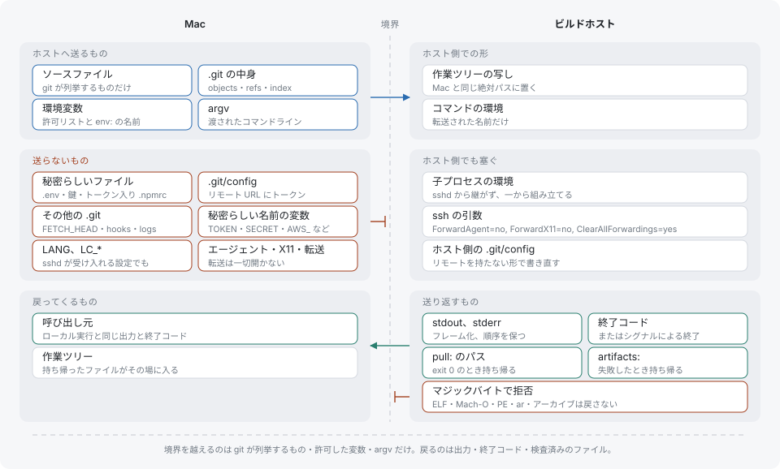

# セキュリティ

sendaway は作業ツリーを別のマシンへコピーし、そこでコマンドを実行します。このページでは、ホストに届くもの、決して届かないもの、ワークステーションに残るものを列挙します。



## ホストに届くもの

- git が追跡するファイルと、git が無視していない未追跡ファイル。ただし、後述のシークレットセットは除きます。
- `.git` ディレクトリ。ただし `config`、`FETCH_HEAD`、`hooks/`、`logs/`、`*.lock`、`objects/tmp_*` は除きます。ホストには、リモート、URL、credential helper を持たない最小限の `.git/config`（`repositoryformatversion = 0`、`bare = false`）が渡されます。
- コマンドライン、作業ディレクトリ、許可リストにある環境変数。

ユーザー設定の内容（ホスト名、ルート）は何も送られません。

## シークレットファイル

パスの要素（ディレクトリ名かファイル名）のどれか 1 つが次のパターンに一致すると、そのパスは送られません。比較は大文字小文字を区別しません。

| パターン | 例 |
|---|---|
| `.env`、`.env.*` | `.env`、`.env.production` |
| `*.pem`、`*.key`、`*.p12`、`*.pfx`、`*.jks`、`*.keystore` | `server.key`、`cert.pem` |
| `id_rsa*`、`id_ecdsa*`、`id_ed25519*` | `id_ed25519`、`id_rsa.pub` |
| `.netrc`、`.git-credentials`、`.pypirc` | |
| `*.tfstate`、`*.tfstate.*` | `terraform.tfstate.backup` |
| `credentials*.json`、`service-account*.json` | `credentials.json` |
| `secrets`、`.ssh`、`.aws`、`.gnupg` | この名前のディレクトリの配下すべて |

`.env.example`、`.env.sample`、`.env.template` は資格情報を持たないので、対象外です。

rc ファイルのうち `.npmrc` と `.yarnrc.yml` の 2 つは、内容で判定されます。ファイルに `_authToken`、`_auth`、`_password`、`npmAuthToken`、`npmAuthIdent` のいずれかのキーが含まれていると（大文字小文字を区別しない部分文字列の一致）、一致した行だけでなくファイル全体が送られません。読み取れないファイルも送られません。

`.sendaway.yml` の `exclude:` にあるパスは、同じセットに加えられます。名前のルールは固定で、無効にはできません。

送られなかったファイルは、実行の開始時に stderr にすべて列挙されます。

```
[sendaway] not sent (secret-like): .env, config/server.key
```

git が無視するファイルも送られず、列挙もされません。送られなかったファイルや無視されたファイルを必要とするテストは、ホストで失敗します。そのテストは `sendaway local <command>` でローカル実行するか、そのターゲットを `local:` に追加してください。

## 環境変数

ホスト上のコマンドの環境は、ゼロから組み立てられます。内容は次のとおりです。

- ホスト自身の ssh セッションにある `HOME`、`USER`、`LOGNAME`、`SHELL`、`PATH`。
- 転送される変数。
- `SENDAWAY_PASSTHROUGH=1`。

転送される変数は、許可リストと、`env:` の名前のうちローカルで設定されているものです。

```
CI NO_COLOR FORCE_COLOR CLICOLOR_FORCE
MAKEFLAGS CMAKE_BUILD_PARALLEL_LEVEL CTEST_PARALLEL_LEVEL CTEST_OUTPUT_ON_FAILURE
GOFLAGS CGO_ENABLED GOMAXPROCS GOTRACEBACK
RUST_BACKTRACE RUST_LOG
```

許可リストと `env:` のどちらから来た変数でも、次の 2 つのルールで除外されます。

- **シークレットらしい名前**：大文字小文字を区別せずに比較します。`TOKEN`、`SECRET`、`PASSWORD`、`PASSWD`、`CREDENTIAL`、`APIKEY`、`API_KEY`、`PRIVATE_KEY`、`AUTH`、`COOKIE`、`SESSION` を含む名前と、`AWS_`、`GH_`、`GITHUB_`、`NPM_`、`ANTHROPIC_`、`OPENAI_`、`CLOUDFLARE_`、`GOOGLE_`、`AZURE_`、`SSH_` で始まる名前が対象です。
- **Mac 固有の値**：`/opt/homebrew`、`/Applications/`、`/Library/`、`/System/`、`/var/folders/`、`/private/` を含む値と、`$HOME/.` や `$HOME/Library/` で始まる値です。ワークステーションにしか存在しないパスは、ホストでのビルドを壊します。

`sendaway which <command>` は、転送される名前と、`env:` で要求されたもののうち除外された名前を、理由（`secret-like name` または `Mac-specific value`）つきで表示します。値のルールで除外された許可リストの変数は表示されません。

`LANG` と `LC_*` は転送されません。ssh がこれらを送る場合（ssh の設定に `SendEnv` がある場合）は `remote-exec` に届きますが、子プロセスの環境は組み立て直されるため、破棄されます。ロケールはホストのログインプロファイルで設定してください。

## 接続の堅牢化

ssh と rsync の接続はすべて、次のオプションを使います。

```
-T
BatchMode=yes            ConnectTimeout=5
ControlMaster=auto       ControlPersist=10m
ServerAliveInterval=5    ServerAliveCountMax=3
ForwardAgent=no          ForwardX11=no
ClearAllForwardings=yes  GSSAPIDelegateCredentials=no
```

エージェント、X11、ポートの転送はいずれも無効なので、ホストからワークステーションのエージェントやネットワークへ逆向きに到達することはできません。`BatchMode` によりプロンプトは一切出ません。パスワード、パスフレーズ、未知のホスト鍵があると、接続は失敗します。control ソケットのディレクトリ `<state>/cm/` はモード 0700 である必要があり、そうでなければ sendaway はそれを使いません。

ホスト側でも転送を拒否してください。[ビルドホスト](build-host.md)を参照してください。

## ローカルに残るもの

- 状態ディレクトリ `${XDG_STATE_HOME:-~/.local/state}/sendaway/` はモード 0700 で作られ、実行のファイルはモード 0600 です。
- 実行記録には、すべての実行の出力が入ります。コマンドが出力したものは何でも含まれる可能性があります。`meta.json` に環境変数は入りません。
- ローカルロックには、ロックを保持している実行のコマンドラインが記録されます。リモートロックに記録されるのは、実行 ID、開始時刻、pid だけです。
- ユーザー設定、ssh の設定、ssh の鍵がワークステーションを離れることはありません。

`sendaway forget` は、プロジェクトのコピーと sendaway の状態をホストから削除します（[コマンドリファレンス](cli.md#forget)を参照）。ローカルの実行記録には触れません。実行記録は 14 日で、または 100 件を超えた時点で期限切れになります。

## 信頼確認がない理由

sendaway は、プロジェクトの `.sendaway.yml` を有効にする前にも、`prepare:` を実行する前にも、確認を求めません。プロジェクトの `make test` を実行すれば、その時点でプロジェクトのコードが実行されます。それをホストで実行するようにすると、その実行は資格情報を持たないマシンに移ります。このファイルはホストを選べません。ホストはリポジトリの外にあるユーザー設定から決まります。リポジトリが影響を及ぼせる範囲は、このページのルールで限定されています。シークレットフィルタ、環境変数の許可リスト、無効化された転送は、`.sendaway.yml` の内容にかかわらず適用されます。

この理屈は、ビルドホストが使い捨てのビルド環境であることを前提にしています。資格情報、他のマシンへの鍵、ビルド用ユーザーの sudo をホストが持っていると、前提は崩れます。[ビルドホスト](build-host.md#セットアップのチェックリスト)を参照してください。
